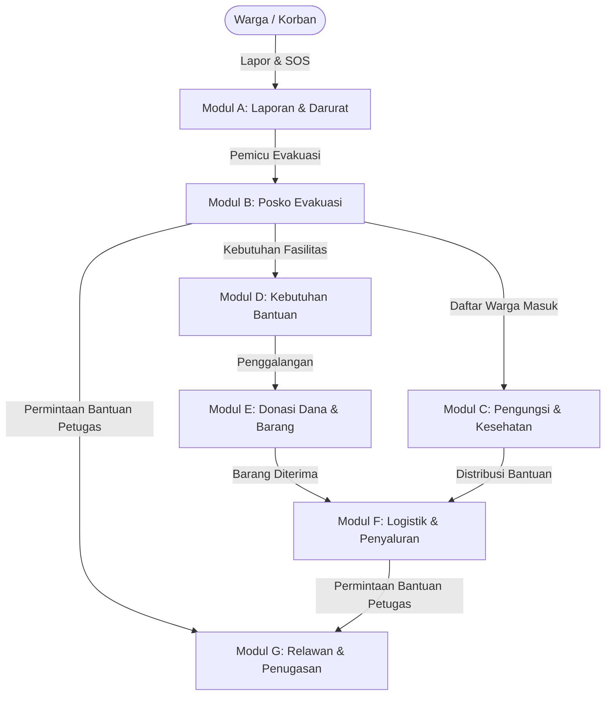

<div align="center">

# 🚨 ResQHub
### *Platform Kolaborasi Masyarakat dalam Kesiapsiagaan dan Respons Bencana*

[](https://laravel.com)
[](https://php.net)
[](https://tailwindcss.com)
[](https://mysql.com)
[](https://telkomuniversity.ac.id)
[](https://sdgs.un.org/goals/goal11)

<br/>

**Proyek Perangkat Lunak (BBK3EAB3)**  
Program Studi S1 Sistem Informasi • Fakultas Rekayasa Industri  
**Telkom University**

</div>

---

## 📌 Tentang ResQHub

**ResQHub** adalah platform web kolaboratif yang mengintegrasikan pelaporan darurat, manajemen posko evakuasi, data pengungsi, pencatatan logistik, penerimaan donasi, hingga penugasan relawan dalam satu ekosistem terpadu secara *real-time*.

Dikembangkan selaras dengan **Tujuan Pembangunan Berkelanjutan (SDG 11.5 & 11.b)** untuk memperkuat resiliensi dan kesiapsiagaan menghadapi bencana di Indonesia.

---

## 👥 Tim Pengembang (Development Team)

<div align="center">

### **Kelompok SI-48-EXT [B-A]**
*Total: 7 Full-Stack Developers • 7 Modul • 21 Product Backlog Items (PBI)*

</div>

<br/>

| No | Foto / Avatar | NIM | Nama Anggota | Peran (Role) | Modul Tanggung Jawab |
| :---: | :---: | :---: | :--- | :--- | :--- |
| **1** |  | `102022580061` | **Ivan Tanjaya Sutrisna** | `Product Owner`<br/>`Full-stack Developer` | **Modul A — Laporan Kejadian & Darurat**<br/>• PBI-01: Laporan kejadian bencana<br/>• PBI-02: Peringatan dini & instruksi evakuasi<br/>• PBI-03: Permintaan bantuan darurat (SOS) |
| **2** |  | `102022580005` | **Maheswari Maharani Mahfud** | `Scrum Master`<br/>`Full-stack Developer` | **Modul B — Posko Evakuasi**<br/>• PBI-04: Posko evakuasi bencana<br/>• PBI-05: Fasilitas posko evakuasi<br/>• PBI-06: Titik kumpul evakuasi |
| **3** |  | `102022580002` | **M. 'Ariq Nafis** | `Full-stack Developer` | **Modul E — Donasi**<br/>• PBI-13: Janji donasi barang<br/>• PBI-14: Rekening donasi resmi<br/>• PBI-15: Donasi dana terverifikasi |
| **4** |  | `102022580021` | **Novendini Faradita** | `Full-stack Developer` | **Modul G — Relawan & Penugasan**<br/>• PBI-19: Profil keahlian relawan<br/>• PBI-20: Tugas relawan & rekomendasi<br/>• PBI-21: Laporan pelaksanaan tugas |
| **5** |  | `102022580041` | **Shalman Rafli Alva Rizqi** | `Full-stack Developer` | **Modul C — Pengungsi & Kesehatan**<br/>• PBI-07: Pendataan pengungsi<br/>• PBI-08: Pemeriksaan dan triase<br/>• PBI-09: Rujukan medis pengungsi |
| **6** |  | `102022580057` | **Muhammad Fadli Raditya** | `Full-stack Developer` | **Modul D — Kebutuhan Bantuan**<br/>• PBI-10: Katalog barang bantuan<br/>• PBI-11: Kebutuhan bantuan posko<br/>• PBI-12: Paket bantuan standar |
| **7** |  | `102022580059` | **Arifin Dwi Saputra** | `Full-stack Developer` | **Modul F — Logistik & Penyaluran**<br/>• PBI-16: Stok logistik posko<br/>• PBI-17: Penerimaan donasi barang<br/>• PBI-18: Penyaluran bantuan posko |

---

## 🏗️ Struktur Modul Sistem



---

## 💻 Tech Stack & Tools

| Komponen | Teknologi |
| :--- | :--- |
| **Back-end Framework** | Laravel 13 (PHP 8.3) dengan arsitektur MVC |
| **Front-end UI** | Blade Templating, Tailwind CSS, Alpine.js, Flowbite |
| **Authentication** | Laravel Breeze |
| **Database & ORM** | MySQL 8.0, Eloquent ORM, Database Migrations & Seeders |
| **Peta & Geospasial** | Leaflet.js, OpenStreetMap, Nominatim Geocoding, Haversine Distance |
| **Background Processing** | Laravel Queues (Database Driver) & Laravel Notifications |
| **Testing & CI/CD** | PHPUnit / Pest PHP, GitHub Actions |
| **Manajemen Proyek** | Jira Software, Slack, Git & GitHub |

---

## 🚀 Panduan Memulai (Quick Start)

### Prasyarat
- PHP >= 8.3
- Composer >= 2.x
- Node.js & NPM
- MySQL Server

### Instalasi Langkah Demi Langkah

1. **Clone repositori:**
   ```bash
   git clone https://github.com/mikaelll-id/ResQHub.git
   cd ResQHub
   ```

2. **Install dependensi PHP & JavaScript:**
   ```bash
   composer install
   npm install
   ```

3. **Konfigurasi Environment:**
   ```bash
   cp .env.example .env
   php artisan key:generate
   ```
   *Sesuaikan pengaturan koneksi database MySQL pada file `.env`.*

4. **Jalankan Migrasi & Seeder:**
   ```bash
   php artisan migrate --seed
   ```

5. **Jalankan Aplikasi:**
   ```bash
   # Jalankan build asset dan server Laravel
   npm run dev
   php artisan serve
   ```
   Aplikasi dapat diakses melalui browser di `http://127.0.0.1:8000`.

---

## 🌿 Alur Kerja Git & Branching

Untuk menjaga konsistensi pengerjaan tim dan menghindari konflik:

1. **Selalu update branch utama sebelum mulai bekerja:**
   ```bash
   git checkout main
   git pull origin main
   ```

2. **Pindah / Buat branch pengerjaan fitur masing-masing:**
   ```bash
   # Contoh pindah ke branch anggota
   git checkout <nama-branch>
   ```

3. **Commit dan Push sesuai konvensi:**
   ```bash
   git add .
   git commit -m "feat(posko): implementasi manajemen fasilitas posko (PBI-05)"
   git push origin <nama-branch>
   ```

---

## 📝 Aturan & Konvensi Commit Pesan (Commit Rules)

Agar riwayat perubahan rapi, mudah dilacak antar anggota tim, dan sesuai standar kolaborasi profesional, seluruh anggota kelompok wajib mengikuti format commit berikut:

### 📌 Format Standar
```text
<tipe>(<nama-modul>): <deskripsi perubahan secara ringkas>
```

### 🏷️ 1. Tipe Commit (`<tipe>`)

| Tipe | Kapan Digunakan? |
| :--- | :--- |
| **`feat`** / **`add`** | Menambahkan fitur baru, halaman baru, atau file baru |
| **`fix`** | Memperbaiki bug, error logika, atau validasi yang bermasalah |
| **`refactor`** | Merapikan / menyusun ulang struktur kode tanpa mengubah fungsi |
| **`docs`** | Menambah atau mengubah dokumentasi (README, proposal, markdown) |
| **`style`** | Mengubah tampilan UI/CSS, merapikan indentasi/format tanpa ubah logika |
| **`test`** | Menambahkan atau memperbaiki Automated Test (Pest/PHPUnit) |
| **`chore`** | Pembaruan dependensi (Composer/NPM), konfigurasi environment, atau build script |

### 📂 2. Cakupan Modul (`<nama-modul>`)

Gunakan nama modul sesuai dengan pembagian tanggung jawab di tim:
- `laporan` : Modul A (Laporan Kejadian & Darurat / SOS)
- `posko` : Modul B (Posko Evakuasi & Fasilitas)
- `pengungsi` : Modul C (Pengungsi, Triase, & Medis)
- `bantuan` : Modul D (Kebutuhan & Paket Bantuan)
- `donasi` : Modul E (Donasi Barang & Dana)
- `logistik` : Modul F (Stok Logistik & Penyaluran)
- `relawan` : Modul G (Relawan & Penugasan)
- *Umum:* `auth`, `database`, `core`, `ui`, `readme`

---

### 💡 Contoh Penulisan Pesan Commit yang Baik

```bash
# Menambah fitur baru pada modul posko
git commit -m "add(posko): tambah form pendaftaran titik kumpul evakuasi (PBI-06)"

# Menambah logika / method baru
git commit -m "feat(donasi): implementasi verifikasi donasi dana via transfer bank (PBI-15)"

# Memperbaiki bug
git commit -m "fix(pengungsi): perbaiki validasi nomor identitas pengungsi duplikat (PBI-07)"

# Merapikan kode controller/service
git commit -m "refactor(relawan): optimasi query rekomendasi penugasan relawan (PBI-20)"

# Menyesuaikan antarmuka / Tailwind
git commit -m "style(laporan): sesuaikan warna badge status darurat bencana"

# Menulis atau memperbarui unit test
git commit -m "test(logistik): buat test case validasi stok barang keluar (PBI-18)"

# Dokumentasi
git commit -m "docs(readme): tambahkan panduan aturan commit tim"
```

> [!TIP]
> **Hal yang Perlu Dihindari:**  
> ❌ Jangan menulis pesan singkat tanpa konteks seperti: `"fix"`, `"update"`, `"revisi"`, `"bismillah"`, `"selesai"`.  
> ✅ Selalu sertakan modul dan penjelasan ringkas apa yang diubah agar rekan tim saat *pull* langsung mengerti perubahannya.

---

<div align="center">
  <sub>Dibangun dengan dedikasi oleh <b>Kelompok SI-48-EXT B-A</b> • Telkom University © 2026</sub>
</div>
